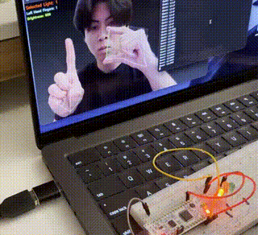

# STM32 Hand-Tracking LED Dimmer

A real-time computer-vision lighting controller that uses **MediaPipe hand tracking** to select one of three LEDs and continuously adjust its brightness. Python converts hand gestures into UART commands, and an **STM32 Nucleo-F303K8** applies the requested brightness with hardware PWM.



**[Watch the hardware demo clip](media/dimmer-demo.mp4)**

## Control scheme

- **Left hand:** hold up 1, 2, or 3 fingers to select Light 1, Light 2, or Light 3.
- **Right hand:** change thumb-to-index pinch distance to control brightness.
- A closed pinch below the lower threshold produces a true `0` brightness command.
- A wide pinch above the upper threshold produces the maximum `999` brightness command.

The final Python script maps approximately **55-150 pixels** of pinch distance to a **0-999** brightness range and sends commands only when the value changes enough to avoid excessive serial traffic.

## Architecture

```text
Webcam
  |
  v
OpenCV + MediaPipe
  |  left hand -> LED selection
  |  right pinch -> 0..999 brightness
  v
Python UART @ 38,400 baud
  |
  v
STM32 Nucleo-F303K8
  |---- PB4 / TIM3_CH1 ---> Light 1
  |---- PB5 / TIM3_CH2 ---> Light 2
  `---- PB3 / TIM2_CH2 ---> Light 3
```

## UART protocol

Commands are newline-terminated ASCII strings such as:

```text
L1:500
L2:999
L3:250
```

The STM32 firmware receives the characters with `HAL_UART_Receive()`, parses the command with `sscanf()`, clamps brightness to 0-999, and updates the selected timer channel using `__HAL_TIM_SET_COMPARE()`.

See [`docs/protocol.md`](docs/protocol.md) for the complete mapping.

## Repository layout

```text
.
├── README.md
├── requirements.txt
├── src/
│   └── python/
│       └── 3DimTest.py
├── firmware/
│   └── CPE185_DimmerLED/
│       ├── CPE185_DimmerLED.ioc
│       ├── Core/
│       ├── Drivers/
│       └── STM32F303K8TX_FLASH.ld
├── docs/
│   └── protocol.md
└── media/
    ├── preview.gif
    └── dimmer-demo.mp4
```

## Python setup

```bash
python3 -m venv .venv
source .venv/bin/activate
pip install -r requirements.txt
python src/python/3DimTest.py
```

The script searches connected serial devices for an STM32/ST-Link style port and opens it at **38,400 baud**.

## STM32 setup

Open or import the project under `firmware/CPE185_DimmerLED` in STM32CubeIDE. The included `.ioc` file records the CubeMX configuration, and the repository includes the project Core and STM32 HAL/CMSIS driver sources from the recovered working project. Build output directories are intentionally excluded from version control.

## Verified project behavior

The working system demonstrated webcam hand detection, 1/2/3-light selection, pinch-based brightness adjustment, UART communication, and independent PWM control of all three LEDs. The demo clip in `media/` shows the physical hardware responding to the gesture interface.

## Engineering takeaways

This project was an early computer-vision/embedded integration prototype that later informed a broader gesture-controlled smart-home system. It required coordinating real-time vision input, a compact serial protocol, PWM timer configuration, hardware wiring, and threshold tuning for stable gesture control.
